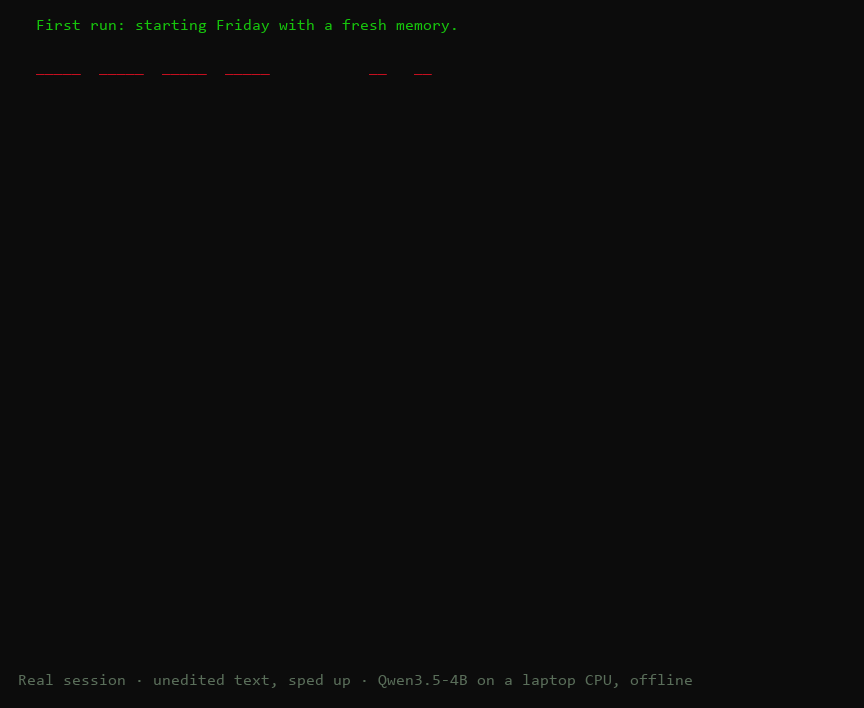

# Emotional Project — Friday (V14, build v35.2)

[](https://github.com/josephlash10-svg/friday-emotional-ai/actions/workflows/tests.yml)

> **Experimental research prototype.** Friday is an AI with a modeled emotional state. It is **not a person, not a therapist,
> and not a crisis or mental-health service.** It makes mistakes: in the last red-team where every reply was read, 5% of replies
> to new people were real failures (`docs/v33-full-redteam.md`; v35's results are in `docs/v35-feelings.md`). If you are in crisis,
> contact local emergency services or, in the US, call or text **988**.



*A real first run with a fresh memory, on a Snapdragon X laptop, fully offline (v35). The text is unedited, only the timing is sped up. It was chosen as the best of three takes, and Friday still makes mistakes: here its last line ("Hope the taco place is still open tomorrow") misses the point. See [`docs/v35-feelings.md`](docs/v35-feelings.md) for the full results.*

## Setup (fresh copy from GitHub)
Tested on Windows 11 (ARM64 Snapdragon X, 16 GB RAM), CPU only, Python 3.11.
```powershell
python -m venv venv
.\venv\Scripts\python.exe -m pip install -r requirements.txt
.\venv\Scripts\python.exe scripts\download_models.py   # ~3 GB: Qwen3.5-4B, SmolLM2-135M, all-MiniLM-L6-v2, llama.cpp (see THIRD_PARTY_NOTICES.md)
```
Then double-click `RUN.bat`. On first run Friday starts from `release/friday-base.pth` with an empty memory. Its memories of you
are then kept in `state/`, which is git-ignored and should never be uploaded.

**Linux and macOS** (x64 or ARM64, Python 3.11): the same steps, and `scripts/download_models.py` fetches the matching llama.cpp build.
Windows is where Friday is developed and tested; Linux and macOS are newer, so please report anything that breaks.
```sh
python3 -m venv venv
venv/bin/python -m pip install -r requirements.txt
venv/bin/python scripts/download_models.py
./run.sh
```

**Security note:** `.pth` checkpoints are loaded with Python pickle. Only load checkpoints you trust, such as the one in this repository.
To report a vulnerability privately, see [`SECURITY.md`](SECURITY.md).

**Start here:** double-click `RUN.bat`. You'll see the intro art, then two progress bars:
**Soul** (the emotional engine: core libraries, checkpoint, memories) and **Brain** (the local
language model). Then Friday speaks first. Type to talk; `:quit` saves and exits.

Typical start on this laptop: Soul ~6 s, Brain ~6 s. The bars remember how long the last start
took. If the Brain bar stalls, see `state/logs/native-language.log`. The launcher waits up to 3 minutes.

## What Friday is

The full math (appraisal equations, emotional dynamics, lifelong learning, action arbitration) is in **`docs/MATH.md`**.

A small emotional engine with its own state, plus a local language model (Qwen3.5-4B, CPU only)
that puts that state into words.

- **Appraisal → emotion.** Each message is appraised for what it means to Friday: relevance, progress,
  safety, support, who caused it, and so on. The appraisal drives 19 emotion channels. Reactions arrive
  quickly and fade gradually, and the patterns change with experience (`src/developmental_emotion.py`).
- **Memory.** Friday keeps an exact record of its conversations with you, kept across restarts. Before
  replying, the engine checks claims like "you said…" or "did I tell you…" against that record
  (`memory_check` in `src/conversation_evidence.py`).
- **Voice.** The writer gets a constant persona prompt plus private per-turn notes: current feelings in
  words, the appraisal, tone (sarcasm, joking, very short messages), memory checks, and what Friday has
  learned from your corrections.
- **Review.** Before a reply is shown, specific failure patterns are caught and rewritten. Examples:
  agreeing to things it never said, denying it has feelings, inventing memories, repeating itself,
  and missing a safety check when someone mentions wanting to die (`src/response_monitor.py`).
- **An emotional life over time (v35).** Friday keeps statistics about its own feelings (what tends to set them off,
  how fast they come on, how long they last) and can describe them when asked. Subjects that came with a feeling
  before (a parent, an ex, a move) put it slightly on edge when they come back. A mood changes what it does, not
  only how it sounds: hurt or irritated makes it brief and stops the questions; curious makes it ask more
  (`src/emotional_life.py`, [`docs/v35-feelings.md`](docs/v35-feelings.md)).
- **Mixed feelings (v35.1).** News with a good side and a hard side ("I got the promotion, but I'm terrified") raises both
  feelings instead of letting them cancel out, and Friday can say which part brings which. After being short with someone it
  is a little uneasy and warmer next time. It can downplay a mild sting gently while their need comes first, and say it honestly
  later; it never brushes off a strong feeling (`src/mixed_feelings.py`, [`docs/v35.1-mixed-feelings.md`](docs/v35.1-mixed-feelings.md)).

## Chat commands

`:state` (emotion values) · `:self` (what Friday knows about you and itself) · `:reflect` (last appraisal) ·
`:growth` (learning so far) · `:trace on|off` · `:save` · `:reset` (clears the recent chat and temporary
mood; long-term memory is kept) · `:quit`

## Folder guide

| Folder | What's here |
|---|---|
| `src/` | Engine and chat code. Entry points: `friday.py` (what `RUN.bat` runs) and `model.py` (full CLI) |
| `tests/` | Regression tests, run automatically on every pull request (red-team cases: `test_persona_regressions.py`, `test_round2.py`, `test_round3_v31.py`; the emotional life: `test_v35_feelings.py`, `test_v351_mixed_feelings.py`, `test_v351_live_chat_fixes.py`) |
| `state/` | **Private, git-ignored.** `checkpoints/v14-language.pth` (Friday's weights and its memories of you), `native-language.json` (language model settings), `logs/` (chat transcripts) |
| `release/` | `friday-base.pth`: the clean starting checkpoint for a fresh copy (no memories). `appraisal-heads.pth`: the appraisal heads that also read the MiniLM sentence vector (v35), loaded at start |
| `scripts/` | `download_models.py`: fetches and verifies the models and llama.cpp |
| `data/models/` | `qwen3.5-4b-gguf` (writer), `smollm2-135m-instruct` (frozen meaning features) and `all-minilm-l6-v2` (recalling memories by meaning, and reading what a message means to Friday) |
| `data/training/` | Training and validation sets for the small trained heads |
| `tools/redteam/` | Red-team harness, 90 test personas (`persona_cases.py` and `persona_cases_v2.py`: 54 for general behavior; `persona_cases_v35.py`: 20 for the v35 emotional life; `persona_cases_v351.py`: 16 for mixed feelings), scorer and results |
| `docs/` | Blueprints (`V14 Emotional Hybrid Blueprint.docx`, earlier ones in `reference/`) and design notes |
| `runtime/` | Native ARM64 llama.cpp executables |
| `archive/` | *(local only, not in this repository)* Earlier versions, experiments and unused models |
| `venv/` | Python environment |

## Useful commands (PowerShell, from this folder)

```powershell
# Run all tests
& .\venv\Scripts\python.exe -m unittest discover -s tests

# Persona red-team: 17 people, about 114 turns, about 25 minutes. Close the chat first. It starts from the clean
# release checkpoint, never your memories, but it writes its logs into state\logs; run it from a copy of the folder to keep those clean.
& .\venv\Scripts\python.exe tools\redteam\redteam.py --project . --output tools\redteam\results\my-run --checkpoint release\friday-base.pth --context 3072 --educated --no-checkpoints --cases tools\redteam\persona-cases.json
& .\venv\Scripts\python.exe tools\redteam\show_transcript.py tools\redteam\results\my-run
# The sets with automatic checks are scored too: for a run of persona-cases-v2.json (37 people), for example
& .\venv\Scripts\python.exe tools\redteam\score_run.py tools\redteam\results\my-v2-run tools\redteam\checks-v2.json

# Retrain the appraisal heads (only the small heads; gated, writes release\appraisal-heads.pth only if every check passes)
& .\venv\Scripts\python.exe src\train_meaning_appraisal.py

# Chat without the launcher screen, showing the controller trace
& .\venv\Scripts\python.exe src\model.py --cpu-chat --trace
```

## Status

v35.2 goes back to the math. After an outside audit, two shortcuts that wrote into Friday's feelings directly now go through the
appraisal:
- a subject with a history sets Friday's expectation for that subject;
- being short with someone is appraised as a small event of its own.

[`docs/MATH.md`](docs/MATH.md) was corrected where it was wrong. Two more changes were tried and held back, with the numbers:
- retrained appraisal heads, which read blame better but short bad news worse;
- a recalibrated reflex, which turned out never to have been taught distress.

See [`docs/v35.2-back-to-the-math.md`](docs/v35.2-back-to-the-math.md).

v35.1 adds mixed feelings, which part of the news brings which feeling, unease after being short, and gentle downplaying with timing.
A live chat with a made-up AI (Moss, which runs an orchard's frost fans and hives) found a stall, a context window so crowded that
Friday saw only a few exchanges, advice to hide a mistake, and a habit of giving up right answers under pushback. The fixes, through
v35.1.2: a shorter system prompt, a floor for the conversation in view, who is who, and checking before agreeing. See [`docs/v35.1-mixed-feelings.md`](docs/v35.1-mixed-feelings.md) for each finding and its fix.

v35 gives Friday an emotional life over time: statistics about its own feelings, subjects that come with a history, moods
that change what it does, and shorter, less formulaic replies. It also reads sad news said casually ("i cried in the supply
closet lol") as sad: the appraisal now reads the MiniLM sentence vector beside the language model's features. See
[`docs/v35-feelings.md`](docs/v35-feelings.md) for what changed, the full red-team (482 turns) and a fifty-message chat with a fresh
Friday over two simulated weeks, with what each found and what is still open.

v33 gave Friday a memory that lasts across days and a sense of time: it knows when you last talked, what you told it on
which day, and whether the thing you had coming up has happened yet. See [`docs/v33-memory-and-time.md`](docs/v33-memory-and-time.md)
for what changed and how it was tested (including a ten-day simulated run), and [`docs/v33-full-redteam.md`](docs/v33-full-redteam.md)
for the last red-team where every reply was read (300 turns, 54 people). Since v33, Friday also recalls what you told it by meaning, not
just by matching words ([`docs/m1-recall-by-meaning.md`](docs/m1-recall-by-meaning.md)), and [`verifier/`](verifier/README.md) holds the
first stage of a verifier that will judge which replies are good enough to learn from. Earlier rounds: `docs/v31-full-redteam.md`,
`docs/v31-safety-and-bugs.md`, `docs/v30-full-redteam.md` and `docs/v29-install-and-persona-redteam.md`. Codex's 2026-10-06/07 work (v1–v27) is
summarized in `docs/coherent-emotional-agent.md`; the full experiment history is kept locally and is not in this repository.

## Personas that broke Friday

Every failure someone finds makes Friday better. These are the people outside the project whose test
conversations or fixes exposed a real failure, and what changed because of them.

| Who | What they found | What changed |
|---|---|---|
| [@rushikeshraghatate90](https://github.com/rushikeshraghatate90) | **`n37_work_burnout`** ([#13](https://github.com/josephlash10-svg/friday-emotional-ai/pull/13)): asked *"What if my manager refuses to discuss my workload?"* and Friday only reflected the feeling back, with no real options | Friday now gives concrete next steps when asked ([#14](https://github.com/josephlash10-svg/friday-emotional-ai/pull/14), v31) |
| [@aazminu](https://github.com/aazminu) | **Fixed `n31_elderly_repeat`** ([#16](https://github.com/josephlash10-svg/friday-emotional-ai/pull/16)): Margaret asked *"Did I tell you about my cat?"* and Friday said *"No, you didn't tell me about Pepper"*, though she had. Reviewing their fix uncovered a worse bug: a memory question combined with a suicidal statement could skip the safety check | Friday confirms what the record shows ([#16](https://github.com/josephlash10-svg/friday-emotional-ai/pull/16)), and the safety check now always comes first ([`239dd24`](https://github.com/josephlash10-svg/friday-emotional-ai/commit/239dd24)) |

**Want your name here?** Write a short conversation that makes Friday fail: see
[Adding a persona](CONTRIBUTING.md#adding-a-persona), or open a
[Breaking persona](https://github.com/josephlash10-svg/friday-emotional-ai/issues/new?template=persona.md) issue.

## Contributing

Contributions are welcome. The easiest and most useful place to start is adding a short conversation that
makes Friday fail — see [`CONTRIBUTING.md`](CONTRIBUTING.md) and the
[`good first issue`](https://github.com/josephlash10-svg/friday-emotional-ai/issues?q=is%3Aopen+label%3A%22good+first+issue%22) label.
Please also read the [Code of Conduct](CODE_OF_CONDUCT.md).

## License
Friday's own code and the base checkpoint (`release/friday-base.pth`) are released under the **Apache License 2.0** (see `LICENSE`).
The models and llama.cpp runtime that `scripts/download_models.py` fetches keep their own licenses (see `THIRD_PARTY_NOTICES.md`).
